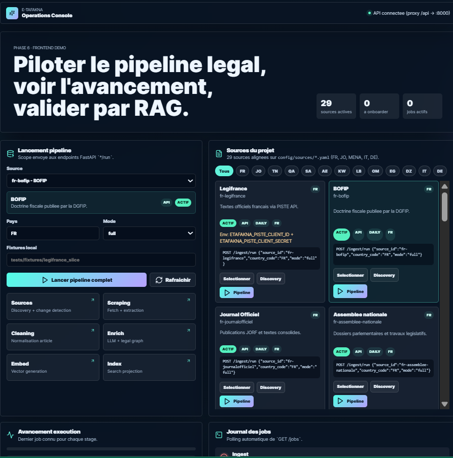

# Legal Brain RAG

**Legal Brain RAG** explore l’analyse et la compréhension de documents juridiques à l’aide de l’intelligence artificielle et d’une approche **RAG (Retrieval-Augmented Generation)**.

Ce dépôt public rassemble une présentation du projet, des documents de stage et des visuels. Les dépôts de code associés sont distincts et ont des périmètres différents.

## Aperçu visuel

### Vision globale de la plateforme


### Extraction et préparation des données

| Flux d’extraction des contrats | Préparation des datasets Hannibal V2 |
|---|---|
| .jpg) |  |

### Console du pipeline



## Organisation des ressources

- [`docs/`](docs/) — documentation et guides
- [`presentation/`](presentation/) — supports et scripts de présentation
- [`rapport/`](rapport/) — rapport et documents de stage
- [`assets/`](assets/) — schémas, captures et logos

> Les dossiers sont créés, mais les documents de rapport et de présentation sont encore à la racine. Les liens ci-dessous reflètent leurs chemins actuels dans le dépôt.

### Documents et guides

- [Guide de démonstration terminal](DEMO_GUIDE_TERMINAL.md)
- [Guide de démo](demo.md)
- [Résumé exécutif du stage](04_resume_executif_stage.md)

### Rapport

- [Rapport de stage (PDF)](Rapport%20stage%202026--Fv3.pdf)
- [Pipeline de stage (HTML)](Pipeline%20de%20stage%20%C2%B7%20E-Tafakna%202026%20-v4.html)

### Présentation

- [Présentation de soutenance (PDF)](Soutenance_ETafakna_v2.pdf)
- [Présentation de soutenance (PowerPoint)](ai%20-%20Soutenance_ETafakna_v3.pptx)
- [Script oral](Script_oral_soutenance.md)
- [Discours de soutenance — Pipeline E-Tafakna 2026](Speech%20de%20soutenance%20%C2%B7%20Pipeline%20E-Tafakna%202026.md)

### Autres visuels dans `assets/`

- [Schéma de complémentarité Legal Brain / Hannibal](assets/Fig.%203.3%20%E2%80%94%20Compl%C3%A9mentarit%C3%A9%20Legal%20Brain___Hannibal%20%201.jpg)
- [Logo iTeam](assets/logo-iteam.png)
- [Logo E-Tafakna](assets/logo_etafakna.png)
- [Visuel](assets/6327d905-95c1-4839-9ad7-f074008ec425.jpg)
- [Visuel](assets/f8b83d46-30ee-4ff4-9059-e46334917cdd.jpg)

## Écosystème et périmètre des dépôts

### `hannibal-finetunning--V2` — Préparation des données

> Dépôt privé : [`lina2306i/hannibal-finetunning--V2`](https://github.com/lina2306i/hannibal-finetunning--V2)

Ce dépôt contient notamment des outils de nettoyage et d’analyse de contrats, de préparation et de rééquilibrage de jeux de données, de génération de données synthétiques et de contrôle qualité liés au travail de fine-tuning.

### `Hack-ai-Legal_Brain` — Partie du projet Legal Brain

> Dépôt privé : [`lina2306i/Hack-ai-Legal_Brain`](https://github.com/lina2306i/Hack-ai-Legal_Brain)

Ce dépôt correspond à une partie du travail sur Legal Brain. Il ne représente pas à lui seul l’ensemble du produit ni tous les composants développés par l’équipe.

### `seifshub/legal-pipeline` — Dépôt associé couvrant plusieurs composants

> Dépôt privé : [`seifshub/legal-pipeline`](https://github.com/seifshub/legal-pipeline) est un dépôt associé et comparable à `Hack-ai-Legal_Brain`, avec un périmètre plus large. Son arborescence comprend notamment des adaptateurs de sources juridiques, des composants d’ingestion et de traitement, l’OCR, l’enrichissement, le stockage, la recherche/RAG, une API, une interface frontend, des tests et des éléments de déploiement.

Les dépôts sont distincts. Cette présentation distingue le dépôt plus large `seifshub/legal-pipeline` de la partie représentée par `Hack-ai-Legal_Brain` et ne revendique pas l’ensemble des développements du premier.

## Vue d’ensemble

```text
Sources et documents juridiques
        │
        ├── hannibal-finetunning--V2 (privé)
        │     préparation des données et jeux de fine-tuning
        │
        └── Legal Brain / legal-pipeline
              ingestion • extraction • enrichissement • indexation
              API • recherche/RAG • interface • tests • déploiement
```

## Confidentialité et usage

Les dépôts `hannibal-finetunning--V2` et `Hack-ai-Legal_Brain` sont privés. Les données juridiques, scripts internes, modèles et configurations qui s’y trouvent ne sont pas publiés dans ce dépôt de présentation.

> Legal Brain est un outil d’assistance à la recherche et à l’analyse. Toute réponse doit être vérifiée à partir des sources juridiques applicables.

## Statut

Projet de stage E-Tafakna, été 2026.
