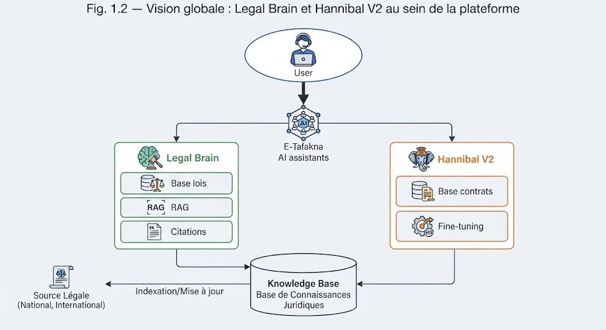

# Legal Brain RAG

**Legal Brain RAG** est un projet orienté vers l’analyse et la compréhension de documents juridiques grâce à une approche de **RAG (Retrieval-Augmented Generation)**.

Ce dépôt public présente l’écosystème du projet. Les composants techniques et les données de travail sont conservés dans les dépôts privés associés.

## Aperçu visuel

### Vision globale de la plateforme



### Extraction et préparation des données

| Flux d’extraction des contrats | Préparation des datasets Hannibal V2 |
|---|---|
| .jpg?raw=true) |  |

## Organisation des ressources

Les dossiers `docs/`, `presentation/`, `rapport/` et `assets/` sont créés. Les documents et médias existants sont encore à la racine du dépôt ; les déplacer réellement nécessite une opération de déplacement/suppression que l’outil d’écriture utilisé ici ne prend pas en charge.

### Documents et guides

- [Guide de démonstration terminal](DEMO_GUIDE_TERMINAL.md)
- [Guide de démo](demo.md)
- [Résumé exécutif du stage](04_resume_executif_stage.md)

### Rapport

- [Rapport de stage (PDF)](Rapport%20stage%202026--Fv3.pdf)
- [Pipeline de stage (HTML)](Pipeline%20de%20stage%20%C2%B7%20E-Tafakna%202026%20-v4.html)

### Présentation

- [Présentation de soutenance (PDF)](Soutenance_ETafakna_v2.pdf)
- [Présentation de soutenance (PowerPoint)](ai%20-%20Soutenance_ETafakna_v3.pptx)
- [Script oral](Script_oral_soutenance.md)
- [Discours de soutenance — Pipeline E-Tafakna 2026](Speech%20de%20soutenance%20%C2%B7%20Pipeline%20E-Tafakna%202026.md)

### Images et schémas

- [Schéma de complémentarité Legal Brain / Hannibal](Fig.%203.3%20%E2%80%94%20Compl%C3%A9mentarit%C3%A9%20Legal%20Brain___Hannibal%20%201.jpg)
- [Capture de la console](fig_4_1_console.png)
- [Logo iTeam](logo-iteam.png)
- [Logo E-Tafakna](logo_etafakna.png)

## Écosystème du projet

### `hannibal-finetunning--V2` — Données et fine-tuning

> Dépôt privé : [`hannibal-finetunning--V2`](https://github.com/lina2306i/hannibal-finetunning--V2)

Ce dépôt constitue la base de préparation des données et du fine-tuning du modèle juridique. Il contient notamment des outils de nettoyage et d’analyse de contrats, de construction et rééquilibrage de jeux de données, de génération de données synthétiques et de contrôle qualité.

### `Hack-ai-Legal_Brain` — Application et orchestration

> Dépôt privé : [`Hack-ai-Legal_Brain`](https://github.com/lina2306i/Hack-ai-Legal_Brain)

Ce dépôt héberge l’environnement applicatif expérimental de Legal Brain : ingestion de documents, recherche sémantique, orchestration RAG et interface ou API.

## Architecture générale

```text
Documents juridiques
        │
        ▼
 hannibal-finetunning--V2 (privé)
 préparation des données • fine-tuning
        │
        ▼
 Hack-ai-Legal_Brain (privé)
 ingestion • recherche • RAG • interface
        │
        ▼
 Réponses contextualisées et fondées sur les sources
```

## Confidentialité

Les dépôts `hannibal-finetunning--V2` et `Hack-ai-Legal_Brain` sont privés. Les données juridiques, scripts internes, modèles et configurations ne sont donc pas publiés dans ce dépôt de présentation.

> Le système est un outil d’assistance à la recherche et à l’analyse ; ses réponses doivent être vérifiées à partir des sources juridiques applicables.

## Statut

Projet en développement.
