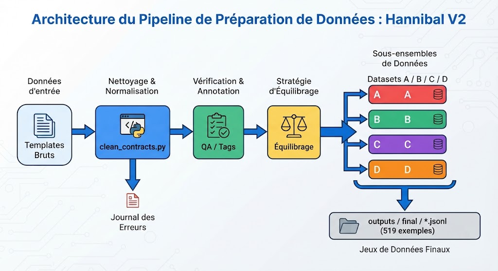

# Legal Brain RAG

**Legal Brain RAG** est un projet orienté vers l’analyse et la compréhension de documents juridiques grâce à une approche de **RAG (Retrieval-Augmented Generation)**.

Ce dépôt public présente l’écosystème du projet. Les composants techniques et les données de travail sont conservés dans les dépôts associés.

## Aperçu visuel

### Vision globale de la plateforme


### Extraction et préparation des données

| Flux d’extraction des contrats | Préparation des datasets Hannibal V2 |
|---|---|
| .jpg?raw=true) |  |

## Organisation des ressources

Les dossiers `docs/`, `presentation/`, `rapport/` et `assets/` sont créés. Les documents et médias existants sont encore à la racine du dépôt ; les liens ci-dessous pointent donc vers leur emplacement actuel.

### Documents et guides

- [Guide de démonstration terminal](DEMO_GUIDE_TERMINAL.md)
- [Guide de démo](demo.md)
- [Résumé exécutif du stage](04_resume_executif_stage.md)

### Rapport

- [Rapport de stage (PDF)](Rapport%20stage%202026--Fv3.pdf)
- [Pipeline de stage (HTML)](Pipeline%20de%20stage%20%C2%B7%20E-Tafakna%202026%20-v4.html)

### Présentation

- [Présentation de soutenance (PDF)](Soutenance_ETafakna_v2.pdf)
- [Présentation de soutenance (PowerPoint)](ai%20-%20Soutenance_ETafakna_v3.pptx)
- [Script oral](Script_oral_soutenance.md)
- [Discours de soutenance — Pipeline E-Tafakna 2026](Speech%20de%20soutenance%20%C2%B7%20Pipeline%20E-Tafakna%202026.md)

### Images et schémas

- [Schéma de complémentarité Legal Brain / Hannibal](Fig.%203.3%20%E2%80%94%20Compl%C3%A9mentarit%C3%A9%20Legal%20Brain___Hannibal%20%201.jpg)
- [Capture de la console](fig_4_1_console.png)
- [Logo iTeam](logo-iteam.png)
- [Logo E-Tafakna](logo_etafakna.png)

## Écosystème et périmètre des dépôts

### `hannibal-finetunning--V2` — Préparation des données

> Dépôt privé : [`hannibal-finetunning--V2`](https://github.com/lina2306i/hannibal-finetunning--V2)

Ce dépôt regroupe des outils de nettoyage et d’analyse de contrats, de construction et de rééquilibrage de jeux de données, de génération de données synthétiques et de contrôle qualité pour le travail autour du fine-tuning.

### `Hack-ai-Legal_Brain` — Contribution au projet Legal Brain

> Dépôt privé : [`Hack-ai-Legal_Brain`](https://github.com/lina2306i/Hack-ai-Legal_Brain)

Ce dépôt correspond à la partie du projet Legal Brain portée dans le cadre de ce travail. Il ne faut pas le présenter comme l’unique dépôt contenant l’intégralité du produit ou de tous les composants développés par l’équipe.

### Dépôt associé de référence : `seifshub/legal-pipeline`

[`seifshub/legal-pipeline`](https://github.com/seifshub/legal-pipeline) est un dépôt associé au pipeline Legal Brain et comparable à `Hack-ai-Legal_Brain`. Son arborescence couvre un ensemble plus large de composants du projet : adaptateurs de sources juridiques, pipeline d’ingestion et de traitement, OCR, enrichissement, stockage, recherche/RAG, API, console frontend, tests et déploiement.

Il s’agit donc d’une base de code couvrant plusieurs parties du projet, et non uniquement les contributions personnelles présentées ici. Les dépôts sont distincts ; ce README ne revendique pas la propriété ni l’ensemble des développements du dépôt `seifshub/legal-pipeline`.

## Vue d’ensemble

```text
Sources et documents juridiques
        │
        ├── hannibal-finetunning--V2 (privé)
        │     préparation des données et jeux de fine-tuning
        │
        └── Legal Brain / legal-pipeline
              ingestion • extraction • enrichissement • indexation
              API • recherche/RAG • interface • tests et déploiement
```

## Confidentialité et usage

Les dépôts `hannibal-finetunning--V2` et `Hack-ai-Legal_Brain` sont privés. Les données juridiques, scripts internes, modèles et configurations ne sont donc pas publiés dans ce dépôt de présentation.

> Le système est un outil d’assistance à la recherche et à l’analyse ; ses réponses doivent être vérifiées à partir des sources juridiques applicables.

## Statut

Projet en développement.
